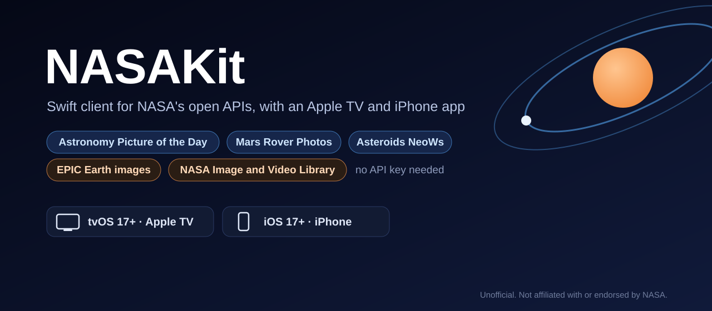
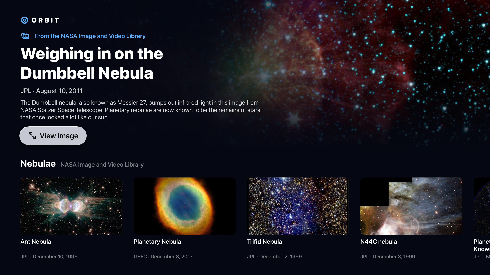
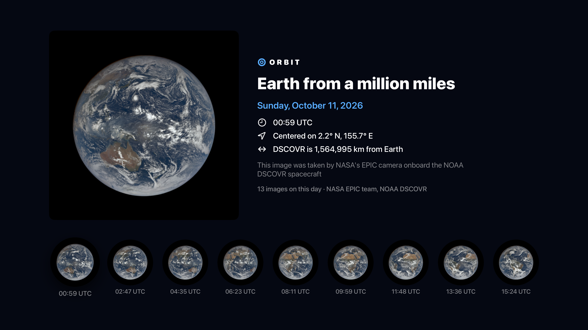
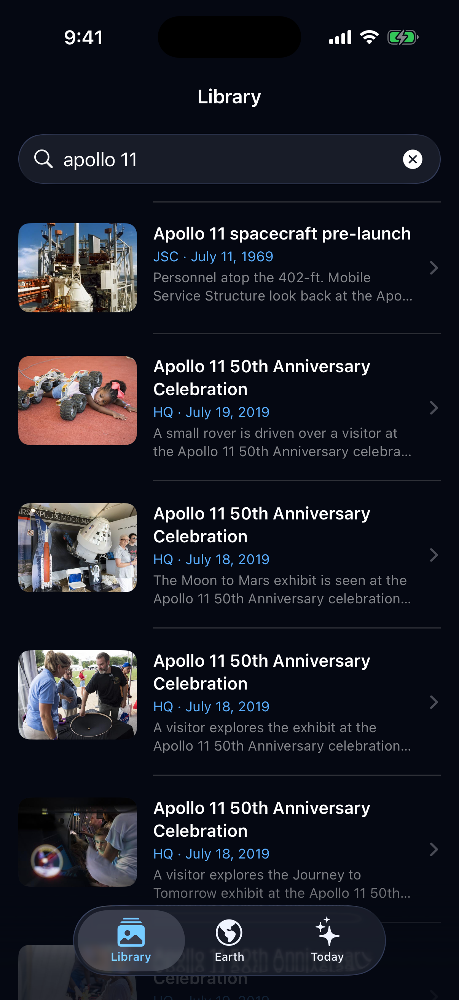
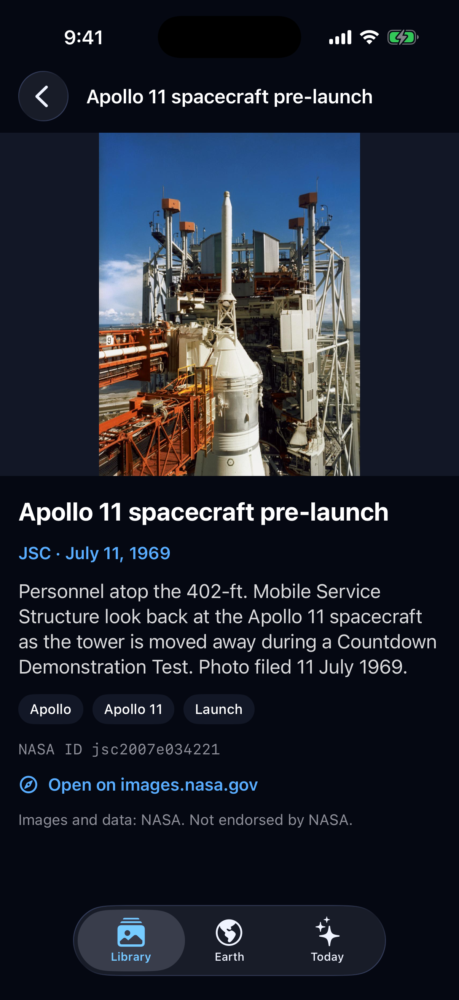
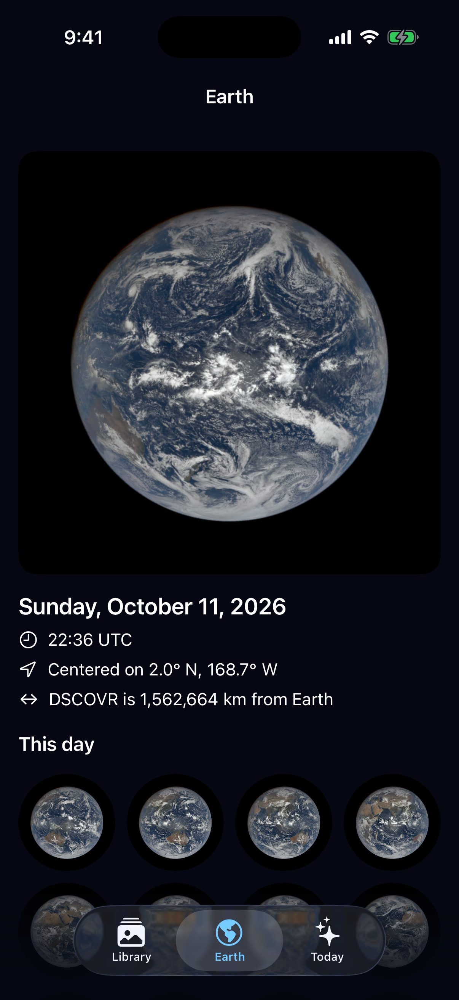

<p align="center">
  
</p>

<p align="center">
  <a href="https://github.com/halilozel1903/NASAKit/actions/workflows/ci.yml"></a>
  
  
  
  
  
  <a href="LICENSE"></a>
</p>

**NASAKit** is a Swift client for NASA's open APIs, with an example app for **Apple TV and iPhone**. Get the Astronomy Picture of the Day (one day, a range of days or random picks), Mars rover photos, near-Earth asteroids from NeoWs, full-disc images of Earth from the EPIC camera, and search the NASA Image and Video Library. Every endpoint is an `async throws` method returning typed models. The api.nasa.gov key defaults to `DEMO_KEY`, and the rate-limit headers of each answer are exposed. EPIC and the Image and Video Library also work without any key. No dependencies.

```swift
import NASAKit

let nasa = NASAClient(apiKey: "YOUR_KEY")                    // or NASAClient() for DEMO_KEY

let today = try await nasa.apod()
print(today.title, today.mediaType)                          // image, video or other
print(today.displayImageURL as Any)                          // the image, or a video's thumbnail

let earth = try await nasa.epicImages(.natural)              // keyless: epic.gsfc.nasa.gov
let photo = earth.last?.imageURL(.jpg)                       // archive URL builder

let found = try await nasa.searchMedia("apollo 11")          // keyless: images-api.nasa.gov
print(found.totalHits ?? 0, found.items.first?.title ?? "")

print(nasa.lastRateLimit?.remaining as Any)                  // X-RateLimit-Remaining
```

## Screenshots

Captured live in CI from the example app, *Orbit*, on an Apple TV 4K and an iPhone simulator. Every screen shows real data and images loaded from NASA's APIs during the CI run: NASA Image and Video Library results for "nebula", "apollo 11" and "international space station", and the latest day of EPIC images from epic.gsfc.nasa.gov. Nothing is bundled or drawn; if the data or any image on screen fails to load, the CI run fails instead of committing a screenshot.

| Discover | Earth |
| :---: | :---: |
|  |  |

| Search | Detail | Earth |
| :---: | :---: | :---: |
|  |  |  |

The scenes use the keyless APIs on purpose: `DEMO_KEY` allows 30 requests an hour per IP address, and CI runners share addresses. When the repository has a `NASA_API_KEY` secret, CI also captures the Astronomy Picture of the Day scenes (`tv-apod.png`, `iphone-apod.png`) with that key; without one they are skipped, never faked.

## Features

- **Five NASA APIs, one client**: the Astronomy Picture of the Day, Mars Rover Photos and Asteroids NeoWs on api.nasa.gov; EPIC both on api.nasa.gov and keyless on epic.gsfc.nasa.gov; and the keyless NASA Image and Video Library on images-api.nasa.gov. See the table below.
- **APOD media types handled**: `mediaType` is `.image`, `.video` or `.other(String)`. `displayImageURL` gives the image for pictures and the thumbnail for videos (requested with `thumbs=true` by default), `bestImageURL` the HD image, `videoURL` and `youTubeID` the video. Copyright lines are cleaned of the API's stray line breaks.
- **Typed models that match the JSON**: NeoWs sends speeds and distances as strings, and they arrive as `Double`s; feed days, Earth dates and archive days are `CalendarDate`s; EPIC's `"2019-05-30 00:13:59"` and the library's ISO dates are `Date`s. Old `http://` links to NASA hosts are upgraded to HTTPS, so App Transport Security doesn't block them.
- **URL builders**: EPIC archive URLs (`png`, `jpg`, `thumbs`) for the keyless archive or api.nasa.gov, and the sizes of a library item (`~large.jpg`, `~medium.jpg`…, videos, captions, metadata) from its asset list.
- **API key and rate limits**: the key defaults to `DEMO_KEY` and can come from the `NASA_API_KEY` environment variable. `lastRateLimit` holds the latest `X-RateLimit-Limit` and `X-RateLimit-Remaining`, and `NASAError.rateLimited` carries them too.
- **Clear errors**: `NASAError` tells a used-up key from a rejected one, keeps the server's own message for bad requests (`"Date must be between Jun 16, 1995 and …"`), and checks arguments such as APOD's 1–100 `count` and NeoWs' seven-day feed before anything is sent.
- **Testable**: point the client at any `URLSession` and base URLs. The package's own tests answer every request from a `URLProtocol` stub and JSON fixtures in the APIs' real formats, never the network.
- **Swift 6 strict concurrency**: the client and every model are `Sendable`. Tested with Swift Testing on macOS and on iOS and tvOS simulators.

## API coverage

| Endpoint | Method | Key |
| --- | --- | --- |
| `GET /planetary/apod?date=&thumbs=` | `apod(date:thumbnails:)` → `APODEntry` | api.nasa.gov |
| `GET /planetary/apod?start_date=&end_date=` | `apod(from:through:thumbnails:)` → `[APODEntry]` | api.nasa.gov |
| `GET /planetary/apod?count=` | `randomAPOD(count:thumbnails:)` → `[APODEntry]` | api.nasa.gov |
| `GET /mars-photos/api/v1/rovers/:rover/photos?sol=` | `marsPhotos(rover:sol:camera:page:)` → `[MarsPhoto]` | api.nasa.gov |
| `GET /mars-photos/api/v1/rovers/:rover/photos?earth_date=` | `marsPhotos(rover:earthDate:camera:page:)` → `[MarsPhoto]` | api.nasa.gov |
| `GET /mars-photos/api/v1/rovers/:rover/latest_photos` | `latestMarsPhotos(rover:camera:page:)` → `[MarsPhoto]` | api.nasa.gov |
| `GET /mars-photos/api/v1/manifests/:rover` | `marsManifest(rover:)` → `MarsMissionManifest` | api.nasa.gov |
| `GET /mars-photos/api/v1/rovers` | `marsRovers()` → `[MarsRoverInfo]` | api.nasa.gov |
| `GET /neo/rest/v1/feed?start_date=&end_date=` | `neoFeed(from:through:)` → `NEOFeed` | api.nasa.gov |
| `GET /neo/rest/v1/neo/:id` | `neo(id:)` → `NearEarthObject` | api.nasa.gov |
| `GET /neo/rest/v1/neo/browse?page=&size=` | `browseNEOs(page:size:)` → `NEOBrowsePage` | api.nasa.gov |
| `GET /api/:collection` · `/api/:collection/date/:date` | `epicImages(_:date:source: .direct)` → `[EPICImage]` | none (epic.gsfc.nasa.gov) |
| `GET /EPIC/api/:collection` · `…/date/:date` | `epicImages(_:date:source: .apiGateway)` → `[EPICImage]` | api.nasa.gov |
| `GET /api/:collection/available` | `epicAvailableDates(_:source:)` → `[CalendarDate]` | either |
| `/archive/:collection/:yyyy/:MM/:dd/:format/:image` | `image.imageURL(.png)`, `epicImageURL(for:format:source:)` → `URL` | either |
| `GET /search?q=&media_type=&year_start=…` | `searchMedia(_:)` with `NASAMediaQuery`, or `searchMedia(_:mediaType:page:pageSize:)` → `NASAMediaSearchResult` | none (images-api.nasa.gov) |
| `GET /asset/:nasa_id` | `mediaAsset(nasaID:)` → `NASAMediaAsset` | none |
| `GET /metadata/:nasa_id` | `mediaMetadataLocation(nasaID:)` → `URL` | none |
| `GET /captions/:nasa_id` | `mediaCaptionsLocation(nasaID:)` → `URL` | none |
| `GET /album/:name` | `mediaAlbum(_:page:)` → `NASAMediaSearchResult` | none |

EPIC collections: `.natural`, `.enhanced`, `.aerosol`, `.cloud`. Rovers: `.curiosity`, `.opportunity`, `.spirit`, `.perseverance`.

## Installation

In Xcode choose **File › Add Package Dependencies…** and enter:

```
https://github.com/halilozel1903/NASAKit
```

Or add it to `Package.swift`:

```swift
dependencies: [
    .package(url: "https://github.com/halilozel1903/NASAKit", from: "1.0.0")
],
targets: [
    .target(name: "MyApp", dependencies: [
        .product(name: "NASAKit", package: "NASAKit"),
    ])
]
```

## Usage

### API key

`DEMO_KEY` is fine for trying things out: api.nasa.gov allows it 30 requests an hour and 50 a day per IP address. A free personal key from [api.nasa.gov](https://api.nasa.gov) allows 1,000 requests an hour.

```swift
let demo = NASAClient()                                    // DEMO_KEY
let mine = NASAClient(apiKey: "YOUR_KEY")
let fromEnvironment = NASAClient.shared                    // NASA_API_KEY if set, else DEMO_KEY

let configuration = NASAConfiguration(
    apiKey: NASAConfiguration.apiKeyFromEnvironment() ?? NASAConfiguration.demoKey,
    userAgent: "MyApp/1.0",
    timeout: 20
)
let nasa = NASAClient(configuration: configuration)
```

The key is only sent to api.nasa.gov, never to epic.gsfc.nasa.gov or images-api.nasa.gov.

### Astronomy Picture of the Day

```swift
let day = try await nasa.apod(date: CalendarDate(year: 2026, month: 10, day: 8))

switch day.mediaType {
case .image:
    show(day.url, hd: day.hdURL)
case .video:
    showThumbnail(day.thumbnailURL, playing: day.videoURL)   // day.youTubeID for YouTube embeds
case .other(let kind):
    print("Interactive entry:", kind)                         // may have no URL at all
}
print(day.copyright ?? "")                                    // nil when there is no copyright line
print(day.pageURL as Any)                                     // https://apod.nasa.gov/apod/ap261008.html

let today = CalendarDate.today(in: TimeZone(identifier: "America/New_York")!)
let week = try await nasa.apod(from: today.adding(days: -6), through: today)   // oldest first
let random = try await nasa.randomAPOD(count: 5)
```

APOD publishes by US Eastern time, so today's picture may not be up yet early in the day. `displayImageURL` is the one to put on screen for any entry: the image, or the video's thumbnail.

### Mars rover photos

```swift
let photos = try await nasa.marsPhotos(rover: .curiosity, sol: 1000, camera: .fhaz)
for photo in photos {
    print(photo.camera.fullName, photo.earthDate, photo.imageURL as Any)   // HTTPS
}

let latest = try await nasa.latestMarsPhotos(rover: .perseverance)
let byDay = try await nasa.marsPhotos(rover: .curiosity, earthDate: CalendarDate(year: 2015, month: 6, day: 3), page: 1)

let manifest = try await nasa.marsManifest(rover: .curiosity)
print(manifest.maxSol, manifest.totalPhotos, manifest.sols.last?.cameras ?? [])
```

Camera names are open (`MarsCameraName` is a string type with constants such as `.navcam` and `.mastcamZLeft`), so new cameras work without a library update.

### Asteroids (NeoWs)

```swift
let start = CalendarDate.today(in: .current)
let feed = try await nasa.neoFeed(from: start, through: start.adding(days: 6))   // at most 7 days

for asteroid in feed.hazardousObjects {
    let pass = asteroid.closestApproachToEarth
    print(asteroid.designation,                                       // "2009 JR5"
          asteroid.estimatedDiameter?.meters.average ?? 0,            // Double, meters
          pass?.missDistance.lunar ?? 0,                              // Earth–Moon distances
          pass?.relativeVelocity.kilometersPerSecond ?? 0)
}

let eros = try await nasa.neo(id: "2000433")                          // every approach and the orbit
print(eros.orbitalData?.orbitClass?.description ?? "")
let page = try await nasa.browseNEOs(page: 0, size: 20)
```

### EPIC: Earth from a million miles

```swift
let images = try await nasa.epicImages(.natural)                      // latest day, oldest first
let day = try await nasa.epicImages(.enhanced, date: CalendarDate(year: 2019, month: 5, day: 30))
let days = try await nasa.epicAvailableDates(.natural)

if let image = images.last {
    image.date                                       // when it was taken
    image.centroid                                   // latitude and longitude at the center
    image.spacecraftDistance                         // DSCOVR's distance from Earth, km
    image.imageURL(.png)                             // 2048 × 2048 PNG, keyless archive
    image.imageURL(.jpg)                             // the same as JPEG
    image.imageURL(.thumbnail)                       // a small thumbnail
    nasa.epicImageURL(for: image, format: .png, source: .apiGateway)   // api.nasa.gov, with your key
}
```

`source: .direct` (the default) talks to epic.gsfc.nasa.gov without a key; `source: .apiGateway` goes through api.nasa.gov/EPIC with the client's key and counts against its limit.

### NASA Image and Video Library

```swift
let result = try await nasa.searchMedia("apollo 11")                 // images by default
for item in result.items {
    print(item.nasaID, item.title, item.metadata.center ?? "", item.metadata.dateCreated as Any)
    print(item.previewURL as Any)                                     // a small preview image
    print(item.metadata.plainDescription ?? "")                       // HTML removed
}

let query = NASAMediaQuery(
    "saturn",
    mediaTypes: [.image, .video],
    yearStart: 2004,
    yearEnd: 2017,
    center: "JPL",
    keywords: ["Cassini"],
    page: 2,
    pageSize: 50
)
let filtered = try await nasa.searchMedia(query)
print(filtered.totalHits ?? 0, filtered.nextPageURL as Any)

let asset = try await nasa.mediaAsset(nasaID: "as11-40-5874")
asset.bestImage()                                  // ~large.jpg, else ~medium, ~small, ~thumb
asset.image(.medium)                               // one size
asset.bestVideo()                                  // for videos
asset.captionsURL                                  // .srt or .vtt, for videos
asset.metadataURL                                  // metadata.json
```

### Errors and rate limits

```swift
do {
    let entry = try await nasa.apod()
} catch let error as NASAError {
    switch error {
    case .rateLimited(let limit): break            // HTTP 429; limit?.remaining == 0
    case .apiKeyRejected(let code, _): break       // API_KEY_INVALID, API_KEY_MISSING…
    case .badRequest(let message): break           // the server's explanation
    case .notFound(let url): break                 // unknown asteroid id, NASA id…
    case .http(let status, let message): break
    case .decoding(let type, let description): break
    case .transport(let urlError): break           // offline, timed out, cancelled
    case .invalidResponse: break
    case .invalidArgument(let message): break      // caught before sending
    }
}

if let limit = nasa.lastRateLimit {                // latest api.nasa.gov answer
    print(limit.remaining, limit.limit ?? 0, limit.isExhausted)
}
```

NASAKit does not retry on its own: a 429 means the key's hourly allowance is used up, and retrying right away only makes it worse. Check `lastRateLimit` before a burst of requests, and cache what you show.

### Testing your code

The client talks to whatever `URLSession` and base URLs you give it, so tests can stub every response:

```swift
let configuration = URLSessionConfiguration.ephemeral
configuration.protocolClasses = [MyStubProtocol.self]

let client = NASAClient(configuration: NASAConfiguration(
    apiKey: "TEST",
    apiBaseURL: URL(string: "https://api.stub.test")!,
    epicBaseURL: URL(string: "https://epic.stub.test")!,
    imagesBaseURL: URL(string: "https://images.stub.test")!,
    session: URLSession(configuration: configuration)
))
```

The models are `Decodable`, so recorded JSON decodes directly: `try JSONDecoder().decode(APODEntry.self, from: data)`.

## Example apps

The `Example` folder contains *Orbit*, built with NASAKit for Apple TV and iPhone:

- **Apple TV**: *Discover*, a NASA Image and Video Library image as the hero and focusable rails of library topics; *Earth*, the latest day of EPIC images with a rail to step through the day; *Picture of the Day*, the APOD entries of the last ten days. Library items open a page with the image in a large size and its description.
- **iPhone**: library search as you type with item pages, the latest EPIC images, and recent APOD entries with the key's remaining requests from `X-RateLimit-Remaining`.

The project uses [XcodeGen](https://github.com/yonaskolb/XcodeGen) so no project file has to live in the repo:

```bash
brew install xcodegen
cd Example && xcodegen generate
open NASAKitDemo.xcodeproj
```

Run `OrbitTV` on an Apple TV simulator and `OrbitPhone` on an iPhone. The app always uses the live APIs. To use your own api.nasa.gov key, set `NASA_API_KEY` in the scheme's environment variables; otherwise it uses `DEMO_KEY`. Launch with `-screenshot home|earth|apod` (Apple TV) or `-screenshot search|detail|earth|apod` (iPhone) to open the scene CI captures; the `apod` scene only loads with a personal key.

## NASA content and attribution

NASAKit is an unofficial client. It is **not affiliated with or endorsed by NASA**, and nothing in this package or its example app implies NASA's endorsement.

NASA's images, video and data are generally not subject to copyright in the United States, so you can usually use them in your app. NASA asks to be credited as the source (for example "Image: NASA"), and its name, logos and insignia may not be used to suggest endorsement. Some content is not NASA's: many Astronomy Pictures of the Day belong to their photographers (`APODEntry.copyright`), and items in the Image and Video Library can include third-party material. Check the [NASA Images and Media Usage Guidelines](https://www.nasa.gov/nasa-brand-center/images-and-media/) before you publish. EPIC images come from the NASA EPIC team on NOAA's DSCOVR spacecraft.

The JSON fixtures used by the unit tests follow the APIs' real formats with sample values. The screenshots and the example app show real, live data.

## Requirements

- Xcode 26 or later (Swift 6.2 toolchain)
- iOS 17+, tvOS 17+ (macOS 14+ for running the tests and using the client on the Mac)

## Contributing

Issues and pull requests are welcome. Please run the tests before opening a PR:

```bash
swift test
bash scripts/test.sh iOS
bash scripts/test.sh tvOS
```

## License

NASAKit is available under the MIT license. See [LICENSE](LICENSE). Content returned by NASA's APIs is not covered by this license; see the section above.
